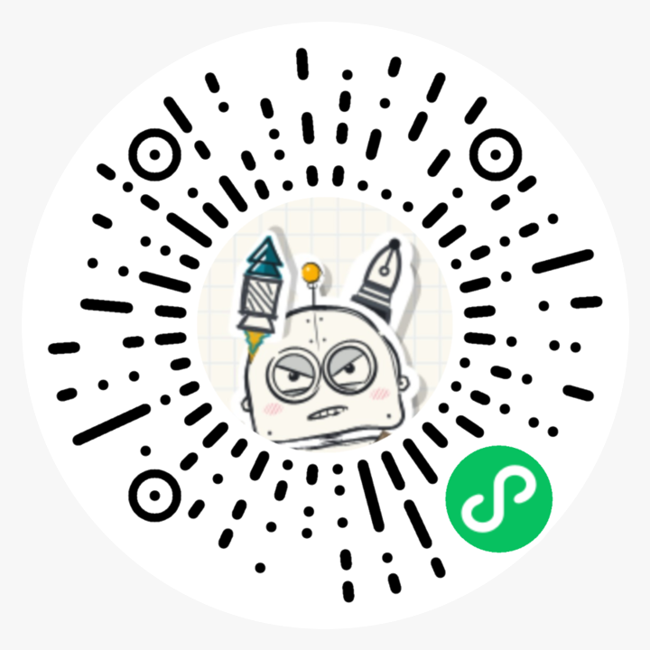
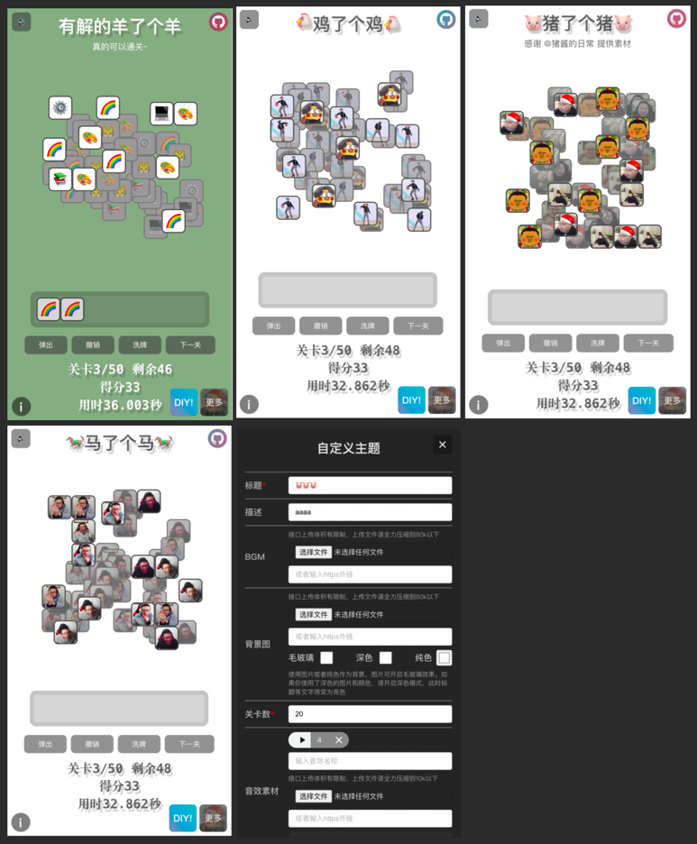
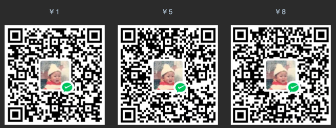

# 能够解出来的 "羊了个羊" 小游戏 Demo

    
    
    
    
    
    
    
    
    
    

> **本项目已归档，不再维护。** 在线体验还开着，排行榜和自定义主题依赖的后台 2023 年就下线了。

## 写在归档前

这是我所有项目里星最多的一个，也是少数没有烂尾的一个。

2022 年 9 月，「羊了个羊」刷屏，第二关几乎没人过得去。我气不过，9 月 15 号建了仓库，当天就把关卡和基础操作写出来了；那一个月提交了 77 次，弹出、撤销、洗牌全部无限次，20 关随便跳，还加了 ikun、金轮、骚猪这些主题，后来又做了自定义主题和排行榜。

然后它就火了。409 个星，170 个 fork。20 个 issue 里不少是「这个怎么部署到宝塔」，有人做了自己的贴图主题，有人提 PR 把洗牌优化成了 O(n)，有人问能不能出安卓版、转 uniapp，还有人刚费劲改完自己的「涩涩版」，就看到我上了自定义主题。同一时间，opendilab 在用强化学习玩羊了个羊（DI-sheep），README 里也挂了它。那是我第一次真切地感受到，自己写的东西被一群陌生人拿去玩、拿去改。

### 第一次被流量教做人

这个项目也让我真切地感受了一把「性能优化」有多重要。

一开始是白嫖 Vercel 部署的，每月有免费额度。没想到能火成这样，又恰好碰上国庆，免费流量直接被打爆，只能为爱发电先充值，然后抓紧做优化：图片和音效一轮轮地压，BGM 只剪一小段、挪去外链（后来干脆放到自己的 MinIO 上），弹窗、主题切换这些组件拆出去按需加载，资源和关卡进度都做了本地缓存。

后台用的是 Bmob 的白嫖额度，为了省请求、省流量，我还跟几 KB 死磕过：文件是转成 base64 塞进 JSON 里存的，所以上传前要把没用到的音效字段删掉，BGM 限 80K、音效限 10K，背景图先在本地压一遍，生成分享链接 15 分钟只能一次。自定义主题的图片和音频一开始是想让大家直接上传的，最后实在扛不住，只好让用户自己找图床、放外链。每 1 KB 的浪费，放大到那个访问量级都是很恐怖的。

### 没有运营意识的技术小伙

流量当时特别高。到写这篇的时候，页面底部那个不蒜子计数是 **445 万次访问、245 万访客**，这还只是我自己这个域名的。

可那会儿我完全没有广告和运营的意识：本职前端开发，经典的「目标是架构师」的技术小伙，只想着把东西做好。按网页广告一千次展示几块钱粗算，这些流量大概能有几千到几万块，但我一分没赚到。反倒是因为开源，不少人直接 fork 过去贴上自己的广告就上线了，等我反应过来，热度已经退了，也就没再折腾。

算到最后其实还是贴钱的。Bmob 的白嫖额度用完续费了一阵，2023 年 5 月到期后就停了，排行榜和自定义主题也跟着下线。

### 现在回头看

放到今天，复刻一个羊了个羊大概就是和 AI 说一句话的事，连我当年死磕的那些优化，AI 也能几分钟给你列一遍。

可回头看，它当年能火，从来不是因为代码写得多好（纯 DOM 实现，方块一多 iOS 上就卡），而是因为赶上了那个时间点，带着一个明确的态度：**这游戏本来挺好玩的，别恶心人，让它能解出来**。再加上一堆网友愿意陪你一起整活。

这些东西，AI 给不了。被流量打爆的那个国庆、为几 KB 较劲的那些晚上，也一样。

## 顺便打个广告

后来我还在做小游戏，这次是正经上线的微信小游戏，也都能解出来：

| 重力律动方块 | 手绘涂鸦大乱斗 |
| :---: | :---: |
|  |  |
| 俄罗斯方块 × 配重物理 × 音乐律动 | 画零件、装部件，拼一台涂鸦战机去对撞 |

—— StreakingMan，2026 年 11 月（本文由 Claude Opus 5.5 执笔，人类成分约 45%）

---

*以下是当年的 README，原样保留。*

坑爹的小游戏（本来玩法挺有意思的，非得恶心人），根本无解（99.99%无解），气的我自己写了个 demo，
扫二维码或<a href="https://solvable-sheep-game.streakingman.com/" target="_blank">pc 浏览器体验</a>

**声明：本项目仅供交流，禁止商用！否则后果自负。基于此项目的二创都是欢迎的，但非二创请不要删除原仓库地址
（啥都不改唯独删除来源我真的会谢 🙄️，请尊重他人劳动成果）**

## Feature

-   弹出：弹出队列左侧第一个，无限次数
-   撤销：撤销上一次操作，无限次数
-   洗牌：哗啦哗啦，无限次数
-   关卡：20 关玩到爽，可直接跳
-   内置主题：金轮、
    骚猪、
    ikun（露出黑脚）等
-   自定义主题：自定义图片和音效，快速整活
-   排行榜：皇城 pk

开心就好 😄

## Contribution

vite+react 实现，欢迎 star、issue、pr、fork（尽量标注原仓库地址）

## Related Repo

<a href="https://github.com/opendilab" target="_blank">opendilab</a> 的 AI 整活！移步
<a href="https://github.com/opendilab/DI-sheep" target="_blank">DI-sheep：深度强化学习 + 羊了个羊</a>

## Todo List

-   [x] 基础操作
-   [x] 关卡生成
-   [x] UI/UX 优化
-   [x] 多主题
-   [x] 计时、得分、保存进度机制
-   [x] 排行榜
-   [ ] 性能优化
-   [x] BGM/音效
-   [ ] ~~点击时的缓冲队列，优化交互动画效果~~
-   [x] 该游戏似乎涉嫌抄袭，考证后补充来源说明
-   [ ] ~~桌面应用~~
-   [x] 路径区分主题
-   [x] 主题自定义
-   [x] 本地图片、音频配置

## 二次开发

项目的自定义主题功能涉及到后台存储（Bmob 懒人数据库），如果您只是简单的整活，可能并不需要相关的逻辑。
详细的二次开发说明请移步这里[DIY 指南](/diy/README.md)

## License

[GNU GENERAL PUBLIC LICENSE Version 3](LICENSE.md)

## 资助

~~由于各种白嫖的静态资源托管、后台服务的免费额度都已用完，目前自费升级了相关套餐。~~
如果您喜欢这个项目，觉得本项目对你有帮助的话，可以扫描下方付款码请我喝杯咖啡 ☕️/~~分摊后台服务费用~~～ 😘

2023.5.5 更新：Bmob 服务到期，后台服务已下线，相关功能暂时无法使用，如有需要请自行搭建后台服务

